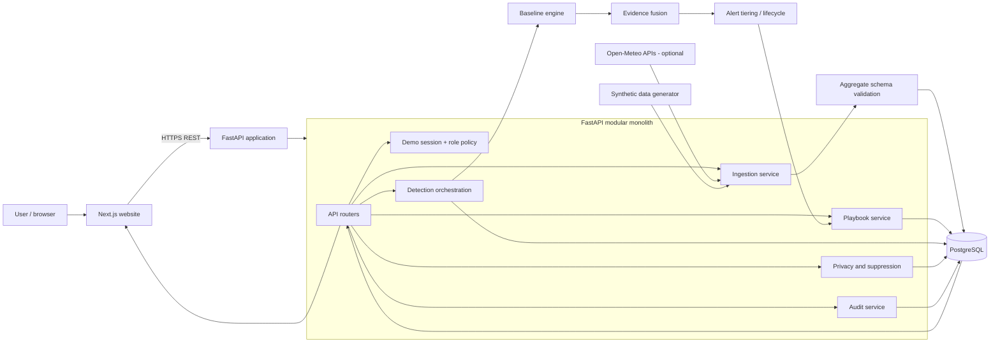
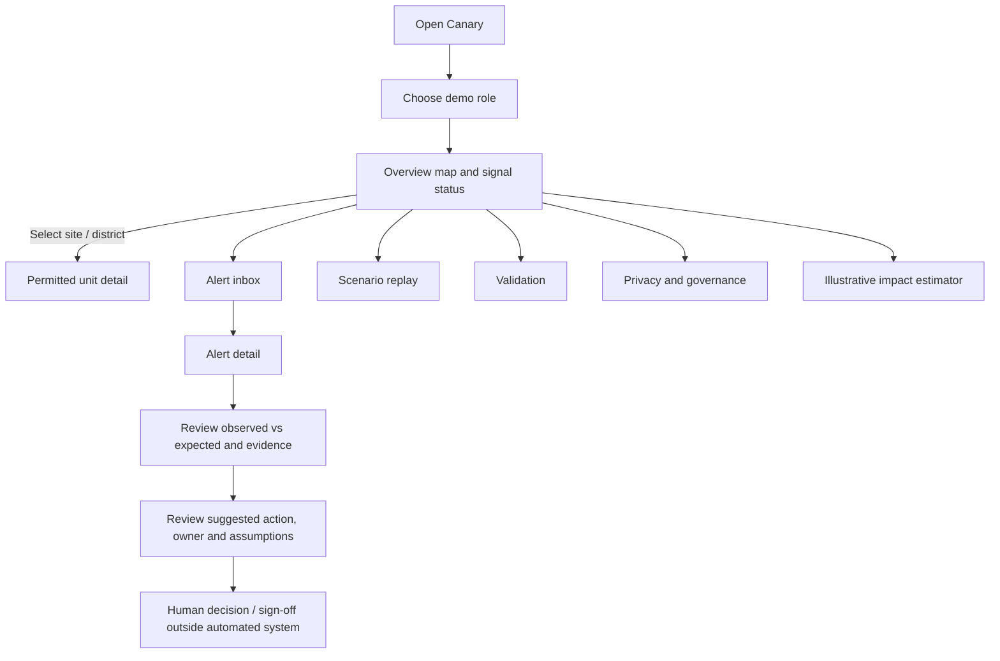
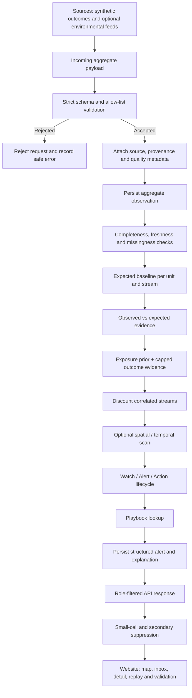
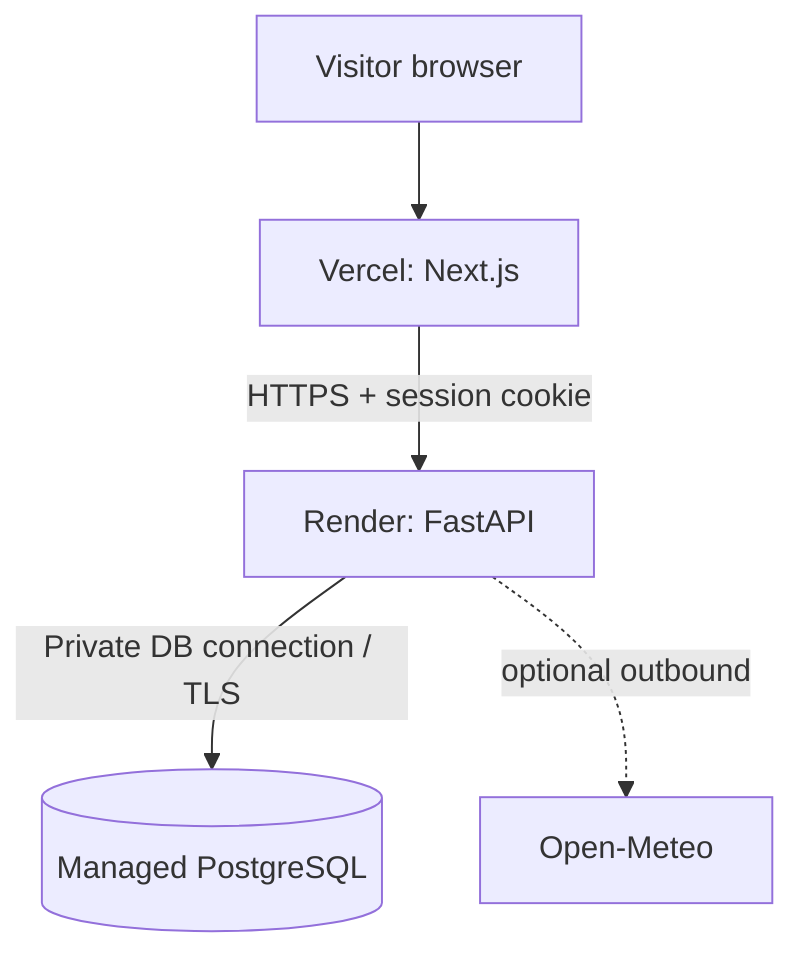

# ARCHITECTURE.md — Canary

**Product:** Canary — Population and Workforce Health Early-Warning Platform  
**Challenge:** Future Health Digital Innovation Challenge, Challenge 06  
**Architecture version:** 1.0  
**Target:** 14-day website prototype; submission target 20 November 2026  
**Status:** Proposed implementation architecture

> This document describes how to implement the requirements in `PRD.md`. The PRD remains the product source of truth. Where delivery time is limited, use the MVP and fallback notes below rather than weakening the privacy boundary, provenance labels, alert explanation, action ownership or validation.

---

## 1. Architecture decisions

The most practical fit for this prototype is a **TypeScript web frontend with a Python API and detection engine**. This keeps the website experience straightforward while allowing the statistical work to use Python's data and modelling ecosystem.

| Area | Decision | Reason |
|---|---|---|
| Frontend | Next.js (App Router) + TypeScript | Fast website development, route structure, reusable UI and straightforward Vercel hosting |
| Styling | Tailwind CSS | Rapid, consistent dashboard styling |
| Maps | Leaflet + React-Leaflet | Lightweight, familiar, sufficient for site/district markers and simple geographic views |
| Charts | Recharts | Good fit for signal trends, contribution breakdowns and validation charts |
| Backend | FastAPI + Python 3.12 | Typed REST API and direct access to the planned statistical/data libraries |
| Data processing | pandas, NumPy | Synthetic data generation, transformations and evaluation |
| Statistical methods | statsmodels, SciPy | Negative-binomial GLM, statistical tests and supporting calculations |
| Database | PostgreSQL | Durable relational storage for aggregate observations, alerts, roles and audit events |
| ORM / migrations | SQLAlchemy 2 + Alembic | Typed persistence layer and repeatable schema changes |
| Validation | Pydantic | Strict API request/response contracts, especially aggregate-only ingestion |
| Background work | CLI/management commands initially | Avoid operating a queue/worker system during a short prototype |
| Local environment | Docker Compose | Reproducible frontend, API and database setup |
| Hosting | Vercel (frontend), Render (FastAPI), managed PostgreSQL | Low-operations cloud deployment with separate deployable services |
| Authentication | Demo role switcher now; authentication-ready boundaries | Supports the hosted read-only demo without spending the prototype window building identity infrastructure |

### Deliberate scope choices

1. **One backend, not microservices.** Ingestion, privacy, detection, playbooks and API routes live in one FastAPI application but remain separate Python modules.
2. **PostgreSQL is the source of truth.** Do not add DuckDB as a second operational database. Use pandas/Parquet only for optional offline evaluation/cache workflows if useful.
3. **No message broker for the prototype.** Run deterministic processing through an explicit command or API-triggered service function. Add a queue only if a measured need appears.
4. **No LLM in the decision path.** Use deterministic templates for alert summaries. Alert tiers, evidence and recommendations are structured outputs.
5. **Leaflet is for visual context, not spatial analytics.** Detection uses site relationships and coordinates from the data model; it must not depend on map rendering.
6. **Authentication is staged.** The prototype role switcher is a demonstration mechanism, not production authentication. Keep role checks in backend dependencies so a real identity provider can replace the demo session later.

---

## 2. System overview

Canary is a modular web application with four main runtime areas:

- **Web client:** overview map, alert inbox and detail, scenario replay, validation, privacy/governance and impact estimator.
- **API and application services:** validates requests, resolves the active role, applies permissions and suppression, reads/writes PostgreSQL and orchestrates the detection workflow.
- **Detection and evaluation engine:** generates or imports aggregate observations, builds expected baselines, fuses independent evidence, assigns alert tiers and calculates evaluation metrics.
- **PostgreSQL:** stores approved aggregate records, monitoring units, alert evidence, recommendations, scenario metadata and audit events.

External environmental APIs are optional inputs. The seeded demo and core workflow must still work if they are unavailable.

### High-level component diagram



### Trust boundaries

- The browser is **not** a trusted security boundary.
- The API is the enforcement point for role permissions, payload validation and suppression.
- Only approved aggregate observations may enter the operational data model.
- Synthetic outcomes and real environmental observations retain explicit provenance metadata.
- External data providers are optional and must not prevent seeded demo operation.

---

## 3. Application flow

### 3.1 User journey



The role selector changes the demonstration view. It does not grant a real-world identity or prove the viewer is the person represented by the selected role.

### 3.2 Data-to-alert flow



**Important ordering:** privacy validation occurs before persistence and before any statistical processing. Suppression is applied to role-specific read views and aggregate outputs; it is not a replacement for the aggregate-only ingestion boundary.

### 3.3 Page-level flow

| Page | Route | Main data | Main interactions |
|---|---|---|---|
| Overview | `/` | Units, current tiers, completeness, freshness | Select site/district; navigate to alerts |
| Alert inbox | `/alerts` | Role-permitted alerts | Filter by tier, hazard, unit; open alert |
| Alert detail | `/alerts/[id]` | Structured alert, evidence, recommendation | Inspect signals and decision-support action |
| Scenario replay | `/replay` | Scenario list and day-specific state | Select scenario and move day by day |
| Validation | `/validation` | Back-test summary, comparator metrics, ablations | Compare methods; inspect synthetic-data label |
| Privacy | `/privacy` | Data contract, suppression examples, audit demo | Change demo role; view masked examples |
| Impact | `/impact` | Scenario assumptions and calculated ranges | Adjust low/base/high assumptions |

All pages must include loading, empty and error states. Synthetic data and illustrative estimates must be labelled visibly, not only in a tooltip or documentation page.

---

## 4. Frontend architecture

### 4.1 Responsibilities

The Next.js application is responsible for:

- Page layout, navigation and responsive dashboard UI.
- Calling the FastAPI REST API.
- Rendering maps, charts, alert evidence and playbook recommendations.
- Displaying role-specific states returned by the API.
- Offering the demo role switcher.
- Showing data provenance, completeness, freshness, uncertainty and decision-support disclaimers.

The frontend must **not** implement the authoritative role policy, suppression rules, alert calculations or ingestion validation. It may hide unavailable controls for usability, but the backend must still reject unauthorized requests.

### 4.2 Frontend state

Keep state simple for the prototype:

- **Server data:** use a small typed API client and fetch data at page/component boundaries. Use SWR or TanStack Query only if caching/revalidation complexity becomes real; do not add both.
- **URL state:** keep shareable filters such as `tier`, `hazard`, `unit_id` and replay `day` in query parameters.
- **Local UI state:** use React state for open panels, selected chart ranges and impact-estimator controls.
- **Demo role:** store the selected demo role in a server-readable cookie/session, not only in React memory or local storage. The API resolves it on each request.

### 4.3 Key UI components

- `AppShell`: sidebar/top navigation, page container and demo environment label.
- `RoleSwitcher`: selects one of the four demo roles.
- `ProvenanceBadge`: labels synthetic, real environmental or illustrative data.
- `CompletenessBadge`: displays available/missing/stale stream status.
- `RiskTierBadge`: text plus visual style; never rely on colour alone.
- `UnitMap`: Leaflet map with site/district markers and accessible legend.
- `SignalTrendChart`: observed values and expected range.
- `ContributionWaterfall`: relative evidence contributions with explanation.
- `AlertCard` and `AlertFilters`: inbox summary and filters.
- `RecommendationPanel`: action, owner role, evidence, assumptions, escalation and review-by date.
- `ReplayTimeline`: deterministic day-by-day scenario navigation.
- `SuppressedValue`: renders a masked value without exposing the underlying count.
- `MetricCard` and `ComparatorChart`: validation metrics with explicit synthetic-data context.

### 4.4 Leaflet implementation notes

- Use React-Leaflet and load map components client-side where required by Next.js.
- Keep site coordinates and map metadata in the units API response.
- Use marker labels/popups with text labels and tier names; do not rely on marker colour alone.
- Provide a list/table alternative for keyboard and screen-reader users.
- Do not display precise coordinates for units that should only be visible at district level.
- If a unit has no reliable geolocation, show its district roll-up rather than inventing a marker.

---

## 5. Backend architecture

Use a **FastAPI modular monolith**. Each domain has a separate module and clear input/output contracts; do not split these modules into separate deployable services during the prototype.

### 5.1 Request lifecycle

1. FastAPI receives the request.
2. Pydantic validates the request shape and types.
3. Demo-session dependency resolves the selected role.
4. Authorization policy checks whether that role may access the requested resource.
5. Service layer fetches or updates data through SQLAlchemy.
6. Privacy layer applies small-cell and secondary suppression to eligible read responses.
7. Audit service records protected-view access and relevant administrative/demo actions.
8. Response schema serializes only fields the role may see.

For ingestion, strict allow-list validation happens before any database write. Unexpected keys must be rejected, not silently ignored.

### 5.2 Domain modules

| Module | Responsibility |
|---|---|
| `api/routers` | HTTP endpoints and dependency wiring only |
| `schemas` | Pydantic request and response models |
| `auth` | Demo session, role enum and authorization dependencies |
| `privacy` | Aggregate-only validation, k-suppression, secondary suppression and role view shaping |
| `services/ingestion` | Source adapters, metadata, validation orchestration and persistence |
| `services/detection` | Runs the baseline → fusion → tiering pipeline |
| `engine/baseline` | Expected-value modelling and residual/evidence calculation |
| `engine/fusion` | Exposure prior, outcome evidence, caps and correlation discounts |
| `engine/tiering` | Watch/Alert/Action, persistence, cooldown and deduplication |
| `engine/scan` | Site graph and 1/3/7-day scan; fallback to site/district aggregation |
| `playbooks` | YAML loading and recommendation selection |
| `services/replay` | Reconstructs a deterministic scenario state for a selected day |
| `services/evaluation` | Back-test, comparators, ablations and metric summaries |
| `services/audit` | Append-only audit event creation and querying |
| `db` | SQLAlchemy models, session management and migrations |
| `data` | Synthetic generator and optional Open-Meteo adapter |

### 5.3 Detection engine boundary

The detection engine accepts normalized aggregate observations and unit metadata. It returns structured evidence and candidate alert state. It does not read HTTP requests, access browser state, render UI content or make clinical decisions.

**Planned pipeline:**

1. Build or load a per-unit/per-stream expected baseline.
2. Compare observed counts with expected values and uncertainty.
3. Use environmental hazard evidence to inform the hazard prior.
4. Add relevant outcome evidence through a transparent fusion method.
5. Cap individual contributions and discount correlated streams.
6. Evaluate site, neighbour and district windows where feasible.
7. Apply tier thresholds, Alert persistence (initially at least 2 of the last 3 days), three-day cooldown and deduplication by unit/hazard.
8. Attach completeness, freshness, uncertainty and provenance.
9. Resolve the playbook entry for hazard/syndrome and tier.
10. Persist the structured alert, contributions and recommendation.

**Modeling requirements retained from the PRD:**

- Negative-binomial GLM baseline with a rolling 12-month fitting window.
- Day-of-week, annual seasonality, holiday and Ramadan/Eid-related effects where represented in data.
- Appropriate aggregate exposure/headcount offset.
- Sparse units may borrow strength from comparable unit types; mark this limitation.
- Missing feeds are dropped from fusion, not silently imputed; uncertainty/completeness must reflect missingness.
- EARS C2 (absence), CUSUM (clinic visits) and fixed heat/PM thresholds remain comparators.
- Do not train an opaque model on the same synthetic labels used for evaluation.
- The fused score is a prioritisation aid, not an individual illness probability.

**14-day implementation fallback:** if the full Poisson space-time scan and Monte Carlo significance estimate are not ready, implement transparent site-level and district-level aggregation. Document that the full scan is deferred. Do not fabricate spatial significance.

---

## 6. Data architecture and PostgreSQL model

PostgreSQL is the operational database. Use SQLAlchemy models and Alembic migrations. Store timestamps in UTC and observation dates in a clearly documented local-date convention for the selected geography; keep the source timezone in metadata where relevant.

### 6.1 Core tables

| Table | Important columns | Purpose |
|---|---|---|
| `districts` | `id`, `name`, `code` | Four demo districts |
| `units` | `id`, `district_id`, `name`, `unit_type`, `latitude`, `longitude`, `headcount_band`, `is_active` | Sites/accommodation/logistics/office units |
| `unit_links` | `source_unit_id`, `target_unit_id`, `relationship_type`, `weight` | Shared accommodation, transport or other site graph links |
| `data_sources` | `id`, `name`, `source_type`, `provenance`, `refresh_cadence` | Synthetic and environmental source registry |
| `aggregate_observations` | `id`, `unit_id`, `source_id`, `observed_on`, `stream`, `category`, `count`, `is_synthetic`, `observed_at`, `ingested_at`, `quality_status`, `metadata_json` | Approved aggregate input |
| `feed_status` | `id`, `unit_id`, `stream`, `last_success_at`, `status`, `completeness`, `missing_reason` | Missing/stale/failed feed visibility |
| `scenario_events` | `id`, `scenario_key`, `event_type`, `start_date`, `end_date`, `severity`, `affected_unit_ids`, `seed_label` | Synthetic ground truth for replay/evaluation |
| `alerts` | `id`, `unit_id`, `district_id`, `hazard`, `tier`, `status`, `window_start`, `window_end`, `started_at`, `updated_at`, `score`, `completeness`, `is_synthetic` | Alert lifecycle |
| `alert_contributions` | `id`, `alert_id`, `stream`, `observed`, `expected`, `contribution`, `correlation_group`, `explanation` | Explainable evidence |
| `recommendations` | `id`, `alert_id`, `action`, `owner_role`, `evidence_json`, `assumptions_json`, `escalation_path`, `review_by`, `guidance_reference` | Structured playbook output |
| `audit_events` | `id`, `actor_role`, `event_type`, `resource_type`, `resource_id`, `created_at`, `request_id`, `details_json` | Protected-view and relevant action log |
| `backtest_runs` | `id`, `run_key`, `calibration_seed`, `test_seed`, `configuration_json`, `created_at`, `status` | Reproducibility metadata |
| `backtest_metrics` | `id`, `run_id`, `method`, `metric_name`, `metric_value`, `unit`, `notes` | Comparator and Canary results |

Use database constraints and indexes for common filters:

- Unique aggregate key across the agreed dimensions (for example `unit_id`, `observed_on`, `stream`, `category`, `source_id`), after confirming whether multiple source records per day are allowed.
- Index `aggregate_observations(unit_id, observed_on, stream)`.
- Index `alerts(tier, status, started_at)` and `alerts(unit_id, hazard, started_at)`.
- Index `audit_events(created_at, actor_role, event_type)`.
- Foreign keys for unit, district, source and alert relationships.

The exact uniqueness rule must be confirmed against the chosen ingestion granularity before the first migration.

### 6.2 Aggregate observation contract

The canonical payload is intentionally small:

```json
{
  "unit_id": "site-001",
  "date": "2026-11-07",
  "category": "respiratory_clinic_visits",
  "count": 7,
  "stream": "health_service",
  "source": "synthetic_demo",
  "is_synthetic": true
}
```

The four core dimensions remain unit, date, category and count. `stream`, source and provenance are approved non-identifying metadata. Do not add person-level identifiers, free-text case notes, names, employee IDs, patient IDs, contact details or individual timestamps.

The API must reject unexpected keys and any row-level/person-level payload. Never log the raw rejected payload if it could contain sensitive data; log a safe validation reason and request ID.

### 6.3 Data provenance

Every observation and derived alert must preserve enough metadata to answer:

- Is this synthetic or real?
- Which source produced it?
- When was it observed?
- When was it ingested?
- Is it fresh, delayed, missing or unavailable?
- Which scenario/seed or source adapter was used?

The UI must label synthetic health-service and workplace outcomes separately from real environmental observations. If Open-Meteo coverage is unavailable or unreliable, use clearly labelled fixtures rather than implying a live feed.

---

## 7. Privacy, access control and demo authentication

Privacy is a core architecture requirement, not a future enhancement.

### 7.1 Role model

| Demo role | Permitted view |
|---|---|
| Site HSE officer | Own-site operational view only |
| Occupational-health lead | Permitted multi-site aggregate view |
| District public-health officer | District-level aggregates |
| Regulator | Compliance indicators only; no health-count detail |

The backend derives allowed units and response fields from the active role. Do not trust a `role` query parameter supplied by the browser as authorization.

### 7.2 Prototype authentication approach

For the 14-day demo:

- Provide a role switcher with four fixed demo roles.
- Store the selected role in a signed, HTTP-only, same-site cookie or equivalent server-validated demo session.
- Resolve the role on the backend for every request.
- Keep the demo environment read-only for normal visitors.
- Restrict any ingestion or reseed endpoint to a development/admin-only path and disable it in the public demo.
- Display “Demo role — not production identity” in the UI.

The cookie signing secret must be an environment variable. Do not hard-code it or commit it.

**Production path (not part of this prototype):** replace the demo-session resolver with a verified OIDC/OAuth identity provider, map verified identity claims to application roles and unit scopes, and retain the same backend authorization policy interface. Do not describe the prototype as having production authentication.

### 7.3 Suppression

- Default small-cell threshold: **k = 5**.
- Mask counts below k in all applicable views.
- Apply secondary suppression or parent-level roll-up when a visible total could reveal a masked cell by subtraction.
- Apply suppression consistently across map popups, charts, tables, filters, exports and API responses.
- Do not send the hidden raw count to the browser and merely cover it with a visual mask.
- Regulator views must not return health-count detail.
- Suppression is not differential privacy. If differential-privacy noise is not implemented with a documented mechanism and epsilon, do not claim it is.

### 7.4 Audit

Record access to protected views and relevant role/view changes. Store the role, event type, resource, timestamp and request ID. Avoid placing sensitive payloads or unnecessary personal data in audit metadata.

### 7.5 Responsible-use boundaries

The product is aggregate-only and must not support individual diagnosis, individual risk prediction, employment profiling, disciplinary action or automated intervention. Every recommendation is decision support and requires human review. Do not make UAE legal-compliance claims until the applicable requirements have been checked by an appropriate source/adviser.

---

## 8. API design

Use a versioned REST API under `/api/v1`. The PRD's initial endpoint names are retained, with version prefixing and explicit response models.

### 8.1 Initial endpoints

| Method | Endpoint | Purpose |
|---|---|---|
| `GET` | `/api/v1/units` | Return units permitted for the active role |
| `GET` | `/api/v1/signals?unit_id&from&to&stream` | Return permitted aggregate signal history |
| `GET` | `/api/v1/alerts?tier&hazard&status` | Return alerts visible to the active role |
| `GET` | `/api/v1/alerts/{alert_id}` | Return evidence, zone, window, recommendation and completeness |
| `GET` | `/api/v1/backtest/summary` | Return validation metrics and run metadata |
| `GET` | `/api/v1/replay/{scenario}?day=` | Return deterministic scenario state for selected day |
| `POST` | `/api/v1/ingest` | Accept approved aggregate records only; disabled or protected in hosted demo |
| `GET` | `/api/v1/privacy/example` | Return safe suppression demonstration data |
| `GET` | `/api/v1/audit` | Return permitted audit demonstration data, if included |

### 8.2 Alert detail response shape

```json
{
  "id": "alert-001",
  "tier": "ALERT",
  "hazard": "respiratory",
  "unit": {
    "id": "site-001",
    "name": "Site 001",
    "district": "District A"
  },
  "window": {
    "start": "2026-11-04",
    "end": "2026-11-07"
  },
  "observed_vs_expected": [
    {
      "stream": "respiratory_clinic_visits",
      "observed": 12,
      "expected": 5.4,
      "contribution": 0.31
    }
  ],
  "contributions": [],
  "completeness": {
    "overall": 0.86,
    "missing_streams": ["sickness_absence"],
    "freshness": "delayed"
  },
  "recommendation": {
    "action": "Review ventilation and respiratory protection arrangements.",
    "owner_role": "occupational_health_lead",
    "evidence": [],
    "assumptions": [],
    "escalation_path": "Escalate if cross-site evidence strengthens.",
    "review_by": "2026-11-08",
    "guidance_reference": "Configured playbook reference"
  },
  "provenance": {
    "outcomes": "synthetic",
    "environmental": "real_or_fixture_label"
  },
  "disclaimer": "Decision support only; human review required."
}
```

This is an illustrative contract. Actual response schemas must use consistent enum values, date formats and nullable fields. Apply role filtering and suppression before serialization.

### 8.3 API conventions

- Use Pydantic models for every request and response.
- Return stable error codes and safe messages.
- Use ISO 8601 dates/timestamps consistently.
- Add pagination if alert history grows beyond the demo dataset.
- Include request IDs in logs and error responses.
- Do not return database models directly.
- Keep OpenAPI documentation enabled for development; consider disabling public interactive docs or limiting them in the hosted demo.
- The browser must never be able to override its role by passing `?role=regulator` or a similar parameter.

---

## 9. Scenario generation, replay and evaluation

### 9.1 Synthetic data generator

The generator should create the PRD's initial dataset:

- 12–15 sites across four districts.
- Construction, labour accommodation, logistics hub and office site types.
- 24 months of daily observations.
- Day-of-week, annual seasonality, public holiday and Ramadan/Eid pattern effects.
- Respiratory, gastrointestinal, heat-related and injury outcome categories.
- District-level teleconsultation query counts.
- 40–60 injected events with event start/end, affected units, type and severity.
- Reporting delays, feed outages, noisy sites and holiday-related absence changes.
- Fixed seeds, with separate calibration and test seeds and different test generator parameters.

Keep generator configuration in YAML or typed Python config. Save the seed and configuration with each evaluation run.

### 9.2 Scenario replay

Replay must be deterministic for a fixed scenario and seed. The replay endpoint returns the state for one day: signal values, completeness, alert state, comparator markers and ground-truth event marker for evaluation/demo use.

Do not create a second detection implementation for replay. Replay should call the same deterministic engine functions used by the back-test harness or load persisted outputs generated by those functions.

### 9.3 Evaluation

Compare:

1. EARS C2 using absence alone.
2. CUSUM using clinic visits alone.
3. Fixed heat or PM2.5 threshold alone.
4. Canary multi-signal fusion.

Report event-level sensitivity, lead time, alert-level PPV, false alerts per site-month, ingest-to-alert latency and ablation/robustness results. Keep calibration and test seeds separate. Label all synthetic evaluation results as simulated; do not describe them as clinical validation.

---

## 10. Playbooks and recommendations

Store editable playbooks under `backend/app/playbooks/rules/` as YAML. A playbook entry is selected by hazard/syndrome and tier and returns:

- Action.
- Responsible role.
- Evidence supporting the suggestion.
- Assumptions.
- Escalation path.
- Review-by interval/date.
- Guidance reference.

Keep recommendation selection deterministic and separate from the detection score. A playbook must not change the tier or retroactively change evidence. Human users decide whether to act; Canary does not dispatch or execute interventions.

The initial respiratory, gastrointestinal and heat examples in the PRD are starting content only. Verify the wording and references against appropriate WHO, ILO and occupational-health guidance before presenting them as sourced recommendations.

---

## 11. Repository and folder structure

Use a simple monorepo so the team can coordinate frontend and backend work while keeping the API contract stable.

```text
canary/
├── README.md
├── PRD.md
├── ARCHITECTURE.md
├── MODEL_CARD.md
├── DATA_GOVERNANCE.md
├── ASSUMPTIONS.md
├── CHANGELOG.md
├── .env.example
├── .gitignore
├── docker-compose.yml
├── Makefile
│
├── frontend/
│   ├── package.json
│   ├── tsconfig.json
│   ├── next.config.ts
│   ├── tailwind.config.ts
│   ├── postcss.config.mjs
│   ├── public/
│   │   ├── icons/
│   │   └── images/
│   └── src/
│       ├── app/
│       │   ├── layout.tsx
│       │   ├── page.tsx
│       │   ├── globals.css
│       │   ├── alerts/
│       │   │   ├── page.tsx
│       │   │   └── [alertId]/page.tsx
│       │   ├── replay/page.tsx
│       │   ├── validation/page.tsx
│       │   ├── privacy/page.tsx
│       │   └── impact/page.tsx
│       ├── components/
│       │   ├── layout/
│       │   │   ├── AppShell.tsx
│       │   │   ├── Sidebar.tsx
│       │   │   └── TopBar.tsx
│       │   ├── map/
│       │   │   ├── UnitMap.tsx
│       │   │   └── MapLegend.tsx
│       │   ├── alerts/
│       │   │   ├── AlertCard.tsx
│       │   │   ├── AlertFilters.tsx
│       │   │   ├── AlertDetail.tsx
│       │   │   ├── SignalTrendChart.tsx
│       │   │   ├── ContributionWaterfall.tsx
│       │   │   └── RecommendationPanel.tsx
│       │   ├── replay/
│       │   │   └── ReplayTimeline.tsx
│       │   ├── validation/
│       │   │   ├── MetricCard.tsx
│       │   │   └── ComparatorChart.tsx
│       │   ├── privacy/
│       │   │   └── SuppressionDemo.tsx
│       │   └── shared/
│       │       ├── RiskTierBadge.tsx
│       │       ├── ProvenanceBadge.tsx
│       │       ├── CompletenessBadge.tsx
│       │       ├── LoadingState.tsx
│       │       └── ErrorState.tsx
│       ├── lib/
│       │   ├── api/
│       │   │   ├── client.ts
│       │   │   ├── units.ts
│       │   │   ├── signals.ts
│       │   │   ├── alerts.ts
│       │   │   ├── replay.ts
│       │   │   └── validation.ts
│       │   ├── types/
│       │   │   ├── api.ts
│       │   │   └── domain.ts
│       │   └── formatters.ts
│       └── hooks/
│           ├── useDemoRole.ts
│           └── useReplayState.ts
│
├── backend/
│   ├── pyproject.toml
│   ├── alembic.ini
│   ├── Dockerfile
│   ├── alembic/
│   │   ├── env.py
│   │   └── versions/
│   ├── app/
│   │   ├── main.py
│   │   ├── core/
│   │   │   ├── config.py
│   │   │   ├── logging.py
│   │   │   └── errors.py
│   │   ├── api/
│   │   │   ├── deps.py
│   │   │   └── routers/
│   │   │       ├── units.py
│   │   │       ├── signals.py
│   │   │       ├── alerts.py
│   │   │       ├── replay.py
│   │   │       ├── validation.py
│   │   │       ├── privacy.py
│   │   │       ├── audit.py
│   │   │       └── ingest.py
│   │   ├── schemas/
│   │   │   ├── common.py
│   │   │   ├── unit.py
│   │   │   ├── signal.py
│   │   │   ├── alert.py
│   │   │   ├── recommendation.py
│   │   │   └── ingest.py
│   │   ├── auth/
│   │   │   ├── roles.py
│   │   │   ├── demo_session.py
│   │   │   └── policy.py
│   │   ├── db/
│   │   │   ├── base.py
│   │   │   ├── session.py
│   │   │   └── models/
│   │   │       ├── unit.py
│   │   │       ├── observation.py
│   │   │       ├── alert.py
│   │   │       ├── scenario.py
│   │   │       └── audit.py
│   │   ├── privacy/
│   │   │   ├── aggregate_contract.py
│   │   │   ├── suppression.py
│   │   │   └── response_filter.py
│   │   ├── engine/
│   │   │   ├── baseline.py
│   │   │   ├── evidence.py
│   │   │   ├── fusion.py
│   │   │   ├── tiering.py
│   │   │   └── scan.py
│   │   ├── playbooks/
│   │   │   ├── loader.py
│   │   │   ├── resolver.py
│   │   │   └── rules/
│   │   │       ├── respiratory.yaml
│   │   │       ├── gastrointestinal.yaml
│   │   │       └── heat.yaml
│   │   ├── data/
│   │   │   ├── synthetic/
│   │   │   │   ├── generator.py
│   │   │   │   ├── patterns.py
│   │   │   │   └── scenarios.yaml
│   │   │   └── sources/
│   │   │       └── open_meteo.py
│   │   └── services/
│   │       ├── ingestion.py
│   │       ├── detection.py
│   │       ├── alert_queries.py
│   │       ├── replay.py
│   │       ├── evaluation.py
│   │       └── audit.py
│   └── tests/
│       ├── conftest.py
│       ├── test_ingest_privacy.py
│       ├── test_suppression.py
│       ├── test_role_access.py
│       ├── test_alert_pipeline.py
│       └── test_replay_determinism.py
│
├── eval/
│   ├── run_backtest.py
│   ├── comparators.py
│   ├── metrics.py
│   ├── ablations.py
│   └── reports/
│
├── fixtures/
│   ├── units.json
│   ├── signals.json
│   ├── alerts.json
│   ├── replay.json
│   └── backtest-summary.json
│
└── docs/
    ├── architecture-notes.md
    ├── limitations.md
    └── api-contract.md
```

### 11.1 Folder ownership rules

- `frontend/src/app`: route composition only; keep large UI pieces in components.
- `frontend/src/components`: reusable visual components; no direct database logic.
- `frontend/src/lib/api`: all HTTP calls and response typing in one place.
- `backend/app/api`: HTTP concerns only; delegate to services.
- `backend/app/engine`: deterministic statistical logic; no FastAPI or SQLAlchemy imports.
- `backend/app/privacy`: reusable validation and suppression functions, covered by tests.
- `backend/app/services`: orchestrates database and engine calls.
- `backend/app/playbooks/rules`: editable content; no detection thresholds hidden in YAML.
- `eval`: reproducible offline evaluation entry points and reports.
- `fixtures`: stable examples for frontend development and API contract tests.
- `docs`: supporting technical notes; product requirements remain in `PRD.md`.

The tree is a target structure, not a requirement to create every empty file on day one. Start with the smallest walking skeleton and add modules as their responsibility is implemented.

---

## 12. Local development and deployment

### 12.1 Local setup

Use Docker Compose for PostgreSQL and the two application services. The exact commands should be documented in `README.md`; the intended developer flow is:

1. Copy `.env.example` to `.env` and set local secrets.
2. Start PostgreSQL.
3. Run Alembic migrations.
4. Seed districts, units, synthetic observations, scenarios and initial playbooks.
5. Start FastAPI and Next.js.
6. Open the website and select a demo role.

Suggested local ports:

- Frontend: `http://localhost:3000`
- Backend: `http://localhost:8000`
- API docs: `http://localhost:8000/docs`
- PostgreSQL: `localhost:5432`

### 12.2 Environment variables

Keep secrets and environment-specific URLs outside source control.

```dotenv
# Backend
APP_ENV=development
DATABASE_URL=postgresql+psycopg://canary:canary@db:5432/canary
DEMO_SESSION_SECRET=replace-with-long-random-secret
CORS_ORIGINS=http://localhost:3000
SMALL_CELL_THRESHOLD=5
DEMO_MODE=true
OPEN_METEO_ENABLED=false

# Frontend
NEXT_PUBLIC_API_BASE_URL=http://localhost:8000/api/v1
```

Use a separate production database URL, session secret and allowed frontend origin in the hosting provider's environment settings. Never put backend secrets in `NEXT_PUBLIC_*` variables.

### 12.3 Cloud deployment

**Frontend — Vercel**
- Deploy the `frontend/` application.
- Configure `NEXT_PUBLIC_API_BASE_URL` to the deployed API base URL.
- Configure production build and environment variables.
- Ensure the frontend does not contain private API or database credentials.

**Backend — Render**
- Deploy the FastAPI service from `backend/` using its Dockerfile or a Python runtime.
- Configure `DATABASE_URL`, `DEMO_SESSION_SECRET`, `CORS_ORIGINS`, `SMALL_CELL_THRESHOLD` and `DEMO_MODE`.
- Run Alembic migrations as a release/pre-deploy command.
- Expose a health endpoint such as `/health`.
- Disable public ingestion and destructive reseed actions in the hosted demo.

**Database — managed PostgreSQL**
- Use a managed PostgreSQL instance in the selected hosting region.
- Enable automated backups if available on the selected plan.
- Use a least-privilege application database user.
- Do not expose the database publicly if the hosting platform supports private networking.

### 12.4 Deployment topology



Configure CORS for the exact deployed frontend origin. If the demo session uses cookies across subdomains, configure `Secure`, `HttpOnly`, `SameSite` and credentialed CORS deliberately and test the deployed browser flow. Prefer same-site deployment domains where practical.

### 12.5 Demo resilience

- Seed PostgreSQL with deterministic data before the demo.
- Core overview, alert and replay screens must work without Open-Meteo.
- Cache or persist environmental observations after a successful fetch; do not make every page load depend on a third-party API.
- If a source feed fails, show stale/missing status and use only explicitly labelled fixtures where the demo requires them.
- Keep a known-good hosted seed and a repeatable reseed script for staging; do not expose reseeding to public viewers.

---

## 13. Testing strategy

### 13.1 Backend tests — must-have

- Ingestion rejects `name`, `employee_id`, `patient_id`, individual records and unknown keys.
- Aggregate counts below k are suppressed.
- Secondary suppression prevents reconstruction from totals.
- Site HSE role cannot retrieve another site's restricted data by calling the API directly.
- District role receives district-level aggregates only.
- Regulator role cannot retrieve health-count detail.
- Protected-view access creates an audit event.
- Missing feeds are excluded from fusion and completeness is reduced.
- Alert persistence, cooldown and deduplication behave as configured.
- Fixed scenario seed and day return deterministic replay output.

### 13.2 Frontend checks

- Each route renders loading, empty and error states.
- Risk tiers have text labels as well as colour.
- Synthetic and illustrative labels are visible.
- Map has a list/table alternative.
- Role switcher changes the API-backed view, not merely the visual controls.
- Suppressed values are never present in the client response payload.

### 13.3 End-to-end smoke test

One critical path should be tested manually or with Playwright:

1. Open overview.
2. Select occupational-health demo role.
3. Open a respiratory alert.
4. Inspect at least two signal contributions and observed-versus-expected values.
5. Read the recommended action, owner, evidence, assumptions and review date.
6. Switch to regulator role and verify health-count detail is unavailable.
7. Open replay and move to a known day.
8. Open validation and verify the simulated-data label.

---

## 14. Delivery plan for the 14-day prototype

The architecture is intentionally staged. Implement the complete vertical slice first; add optional sophistication only after the slice works end to end.

### Phase 1 — Walking skeleton

- Create monorepo and frontend/backend applications.
- Start PostgreSQL through Docker Compose.
- Define Pydantic schemas and the API contract.
- Add fixture-backed `/units`, `/alerts` and `/alerts/{id}` endpoints.
- Render overview, alert inbox and alert detail from real API responses.
- Deploy a basic hosted version early.

**Exit condition:** a seeded alert can be opened in the website from the API.

### Phase 2 — Real prototype data path

- Add aggregate-only ingestion validation.
- Add synthetic generator and seeded scenario data.
- Add migrations and core database tables.
- Add source/provenance and feed-completeness metadata.
- Add the baseline and one multi-signal respiratory alert.

**Exit condition:** synthetic data moves through ingestion, persistence and alert generation.

### Phase 3 — Explainability, privacy and actions

- Add fusion contributions, caps and correlation discounts.
- Add Watch/Alert/Action tiering and lifecycle.
- Add YAML playbook lookup and recommendation response.
- Add role policy and demo session.
- Add k=5 and secondary suppression.
- Add audit logging.

**Exit condition:** alert detail explains why it exists and what a human may consider doing; role and privacy tests pass.

### Phase 4 — Validation and replay

- Add EARS C2, CUSUM and fixed-threshold comparators.
- Add held-out synthetic back-test and metrics.
- Add deterministic replay.
- Add ablations and impact estimator if time permits.
- Add Leaflet map and optional environmental API integration.

**Exit condition:** validation results are reproducible and explicitly labelled simulated.

### Phase 5 — Hardening and submission

- Complete README, model card, data-governance note, assumptions and limitations.
- Test a fresh clone.
- Test hosted demo with read-only roles.
- Verify no raw or row-level data enters logs, API responses or fixtures.
- Freeze features and prepare demo narrative.

### Cut order if behind

Follow the PRD: cut public real-data stretch first, then differential-privacy noise, optional LLM narrative, full spatial scan (use site/district aggregation), advanced replay controls and then the third scenario. Do not cut aggregate-only validation, suppression, role enforcement, provenance, alert explanation, action ownership or core back-testing.

---

## 15. Operational and security checklist

- [ ] `.env` and secrets are excluded from Git.
- [ ] Production CORS allows only the deployed frontend origin.
- [ ] Public demo is read-only.
- [ ] Ingestion/reseed endpoints are disabled or protected in production.
- [ ] Backend authorizes every protected endpoint.
- [ ] Role cannot be escalated by query parameter or client-side state.
- [ ] Aggregate-only schema rejects unknown and person-level fields.
- [ ] Small-cell and secondary suppression happen before response serialization.
- [ ] Regulator response excludes health-count detail.
- [ ] Audit events contain no unnecessary sensitive payload.
- [ ] Synthetic/real provenance survives ingestion, processing and display.
- [ ] Missing feeds are visible and are not silently imputed.
- [ ] Recommendations are labelled decision support and require human review.
- [ ] No claim of diagnosis, clinical validation, legal compliance or production readiness is made.

---

## 16. Architecture trade-offs and future path

| Prototype choice | Why it is right now | Possible next step after the prototype |
|---|---|---|
| FastAPI modular monolith | Fast to build and easy to debug with a small team | Split workers/services only if scale or independent deployment requires it |
| PostgreSQL | One durable store for demo data and audit history | Add partitioning/time-series extensions only after workload evidence |
| Synchronous detection/CLI jobs | Avoids queue and worker operations | Add Celery/RQ or a managed queue for scheduled/large ingestion |
| Demo role session | Enables a controlled demonstration quickly | OIDC identity, verified claims and managed role provisioning |
| Leaflet | Adequate for site and district map | Add richer geospatial storage/querying if spatial analysis needs it |
| Deterministic playbooks and summaries | Traceable and safe for a prototype | Optional language generation strictly after structured decisions |
| Optional Open-Meteo adapter | Real environmental context without blocking the demo | Additional validated source adapters and monitored ingestion schedules |

The architecture creates a path to a future shadow-mode pilot, but the prototype is not itself a production surveillance service. Real deployment would require verified data governance, security review, identity management, operational monitoring, source agreements, domain validation and applicable legal review.

---

## 17. Open implementation decisions

Resolve these during implementation and record the result in `ASSUMPTIONS.md`:

1. Confirm the exact observation uniqueness key and whether multiple sources may report the same unit/date/stream/category.
2. Confirm local-date/timezone handling for the selected UAE locations.
3. Verify Open-Meteo historical air-quality coverage before relying on it.
4. Confirm the clinical-significance threshold used in lead-time evaluation.
5. Verify playbook wording and references.
6. Confirm the hosting region and cookie/CORS configuration for the selected Vercel and Render deployment domains.
7. Confirm whether all three scenarios can be completed; if not, document the deferred scenario and use the PRD cut order.

**Final rule:** keep the implementation explainable, reproducible and privacy-protective. Canary should show what changed, why the evidence matters, what is missing, and which human role should review the situation — never present a black-box score as a diagnosis or an instruction to act automatically.
