<div align="center">

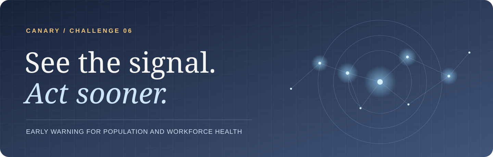

<h1>Canary</h1>

<p><strong>Connect environmental exposure with aggregate health and workplace signals so teams can investigate emerging risk earlier.</strong></p>
<p>Future Health Digital Innovation Challenge · Challenge 06</p>

[](https://github.com/satiricalguru/Canary/actions/workflows/ci.yml)
[](https://github.com/satiricalguru/Canary/actions/workflows/code-review.yml)
[](LICENSE)


[Live demo](https://canary-jatinjio1212-8258s-projects.vercel.app) · [Quick start](#quick-start) · [Product tour](#product-tour) · [Validation](#validation) · [Technical docs](#technical-docs)

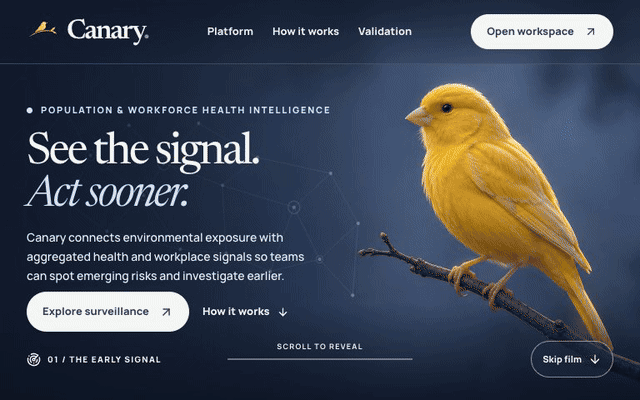

</div>

## See what changed, then decide what to do

Canary is a prototype for occupational health, site safety, and public health teams. Environmental exposure can raise an early watch. Aggregate clinic and workplace signals help confirm whether the pattern warrants closer review.

- **Sense** changes across simulated respiratory, gastrointestinal, and heat stress events.
- **Explain** an alert with observed and expected signals, evidence contributions, a time window, and data completeness.
- **Act** with a suggested response, an owner, assumptions, and a human review step.
- **Protect** aggregate data through schema checks, small-cell suppression, and scoped backend views.

> [!IMPORTANT]
> The workspace is a decision-support demonstration. The Next.js demo uses seeded data and selectable roles. Clinical effectiveness requires real-world validation.

## Product tour

<table>
<tr>
<td width="50%">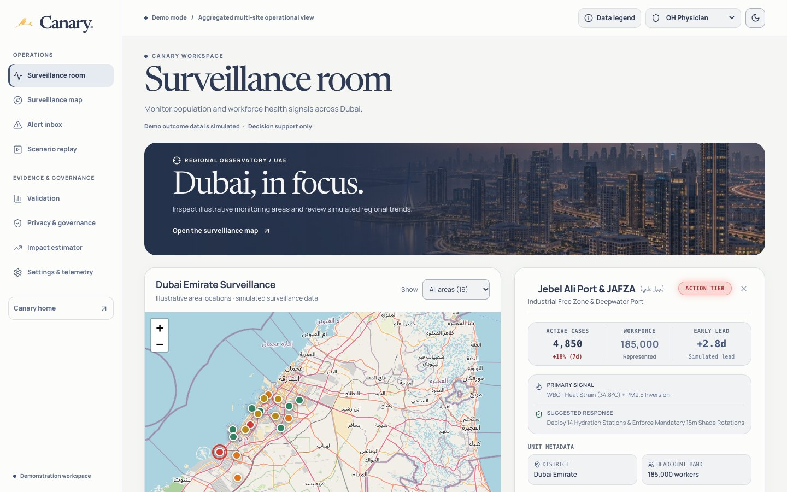<br><strong>01 · Surveillance room</strong><br>Inspect an area, its tier, and supporting context.</td>
<td width="50%">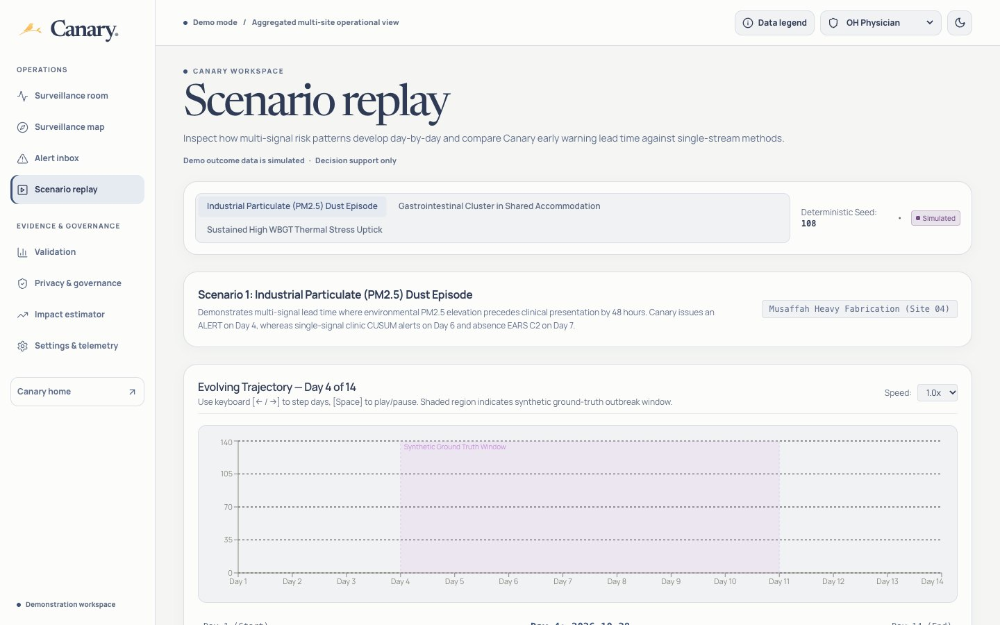<br><strong>02 · Scenario replay</strong><br>Scrub simulated events and compare detector markers.</td>
</tr>
<tr>
<td width="50%">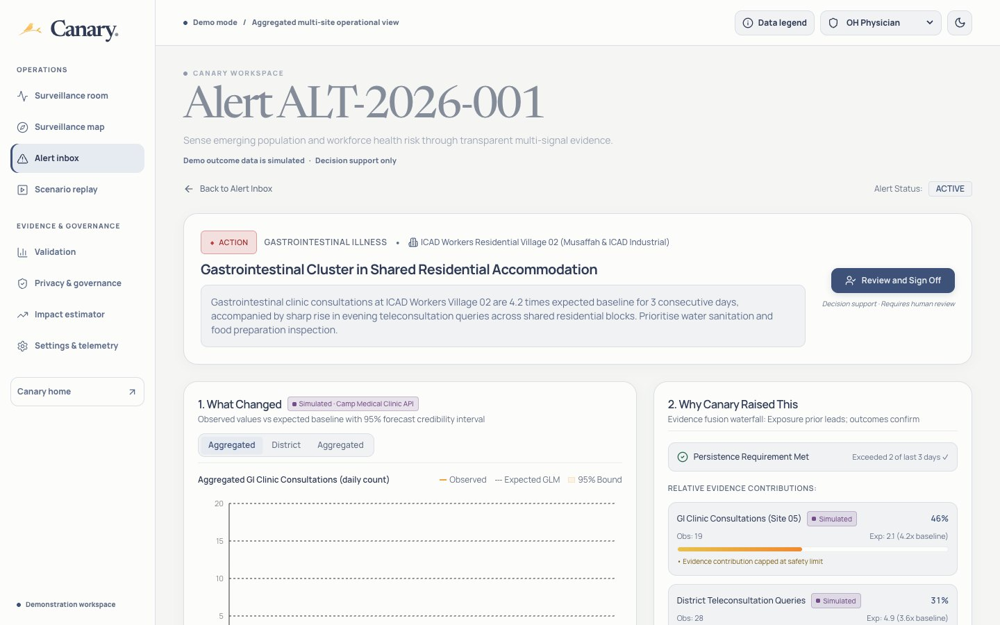<br><strong>03 · Alert evidence</strong><br>Trace what changed, why it was flagged, and how reliable the evidence is.</td>
<td width="50%">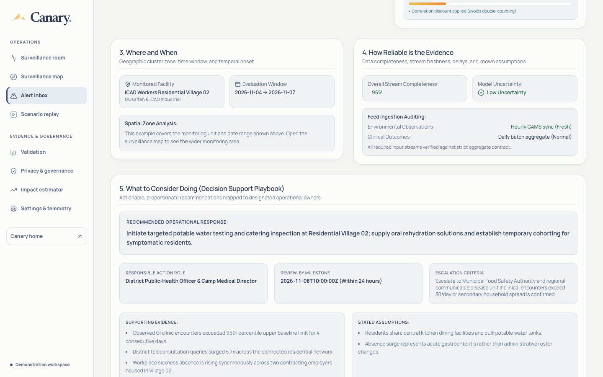<br><strong>04 · Response playbook</strong><br>Review suggested actions alongside evidence and assumptions.</td>
</tr>
<tr>
<td width="50%">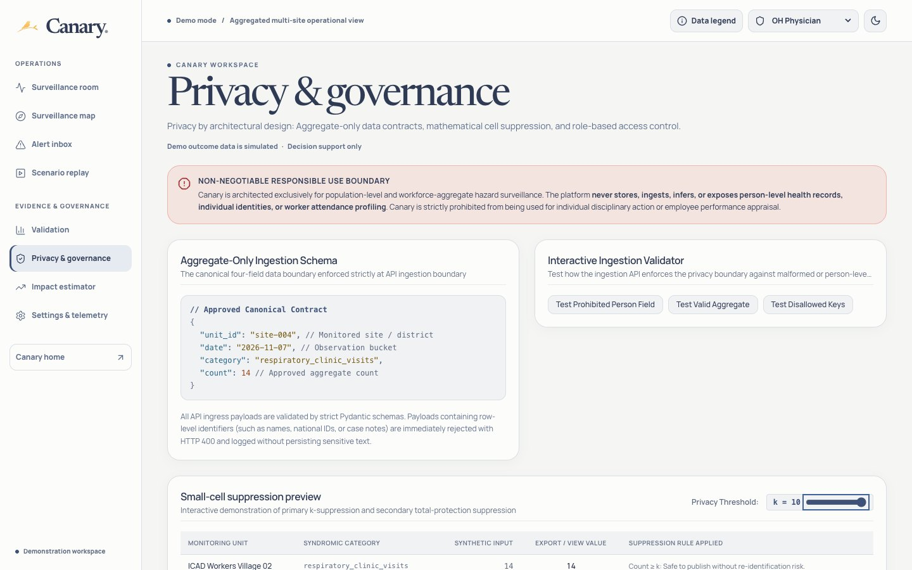<br><strong>05 · Privacy preview</strong><br>Adjust the suppression threshold or test the aggregate ingestion contract.</td>
<td width="50%">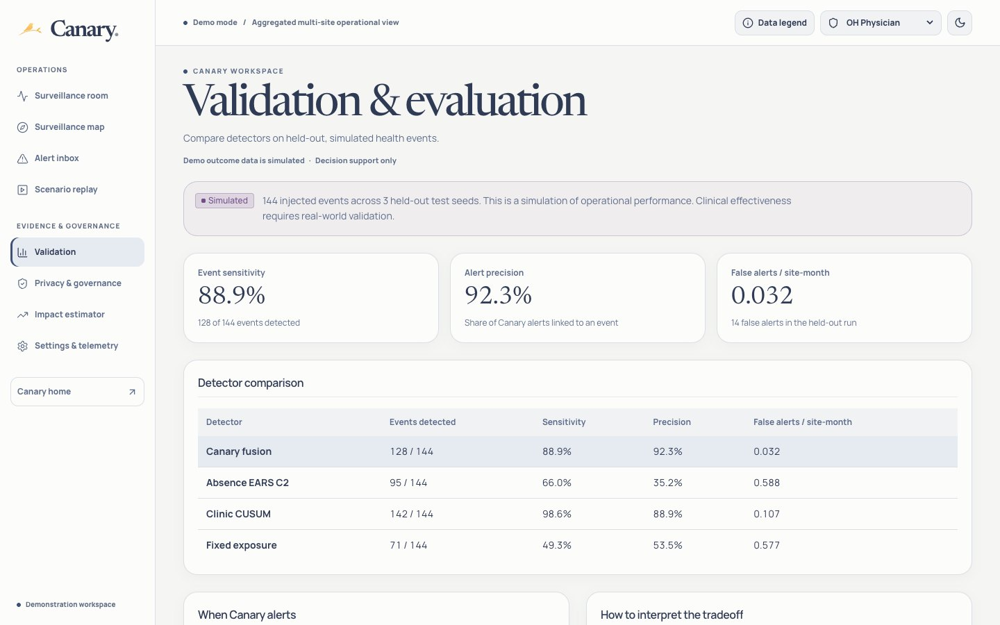<br><strong>06 · Validation</strong><br>Compare detectors and test how missing feeds affect sensitivity.</td>
</tr>
</table>

<details>
<summary>More screens</summary>

| Dark workspace | Mobile landing page |
| --- | --- |
| 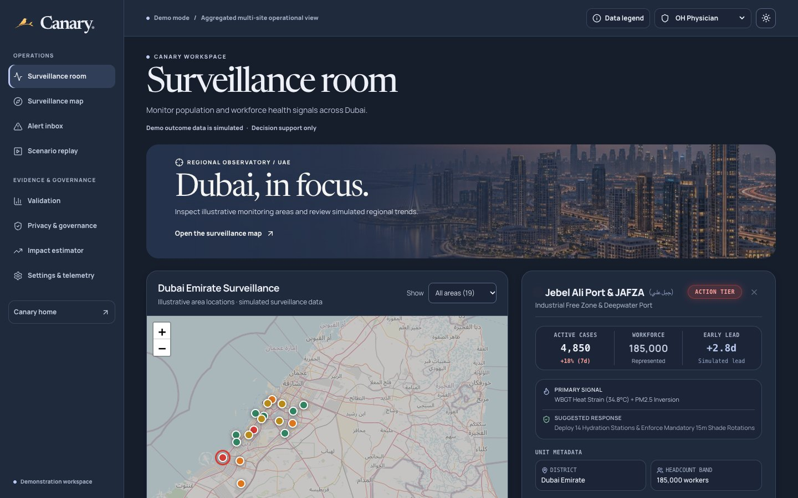 | 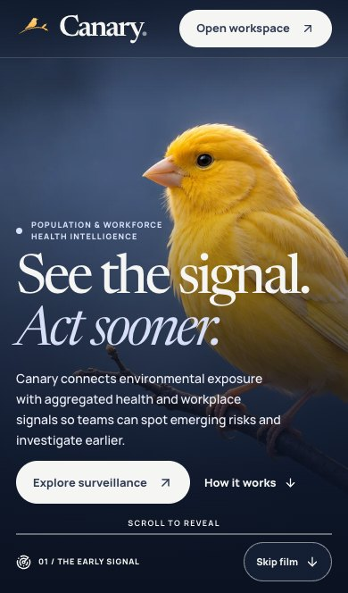 |

| Impact estimator | Settings and telemetry |
| --- | --- |
| 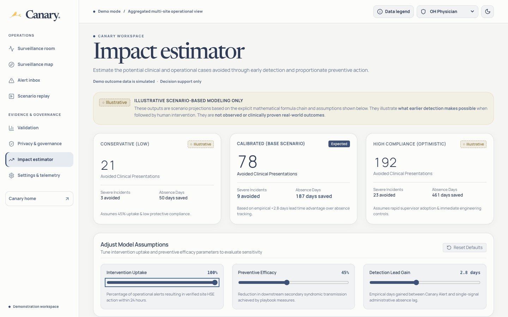 | 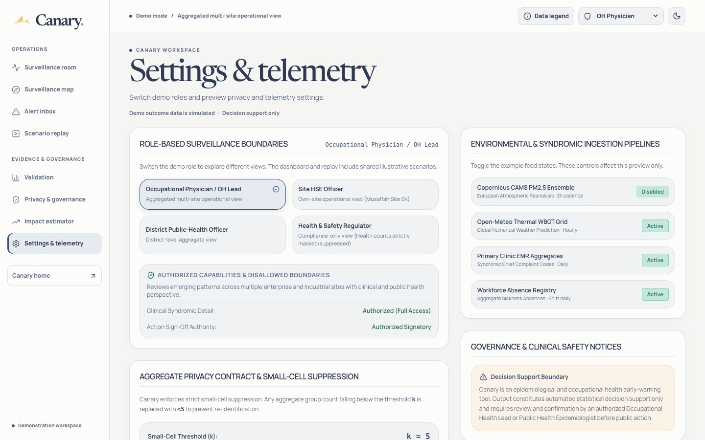 |

</details>

<details>
<summary>See both moments of the landing animation</summary>

| Opening frame | Signals connecting |
| --- | --- |
| 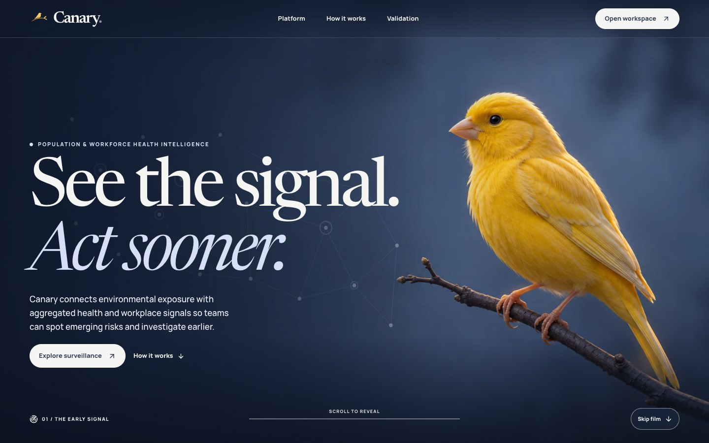 | 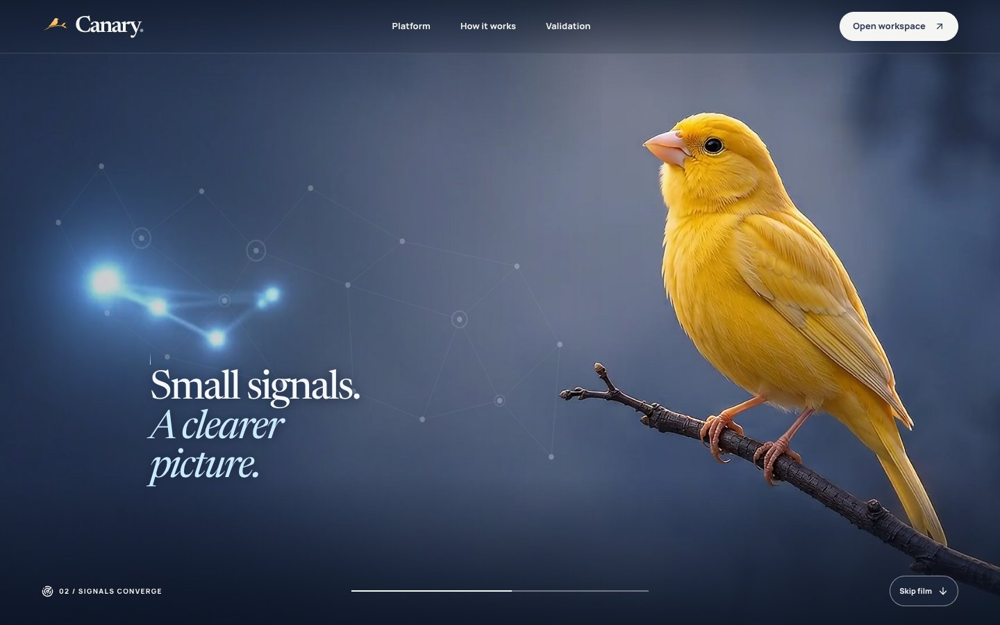 |

</details>

### Narrated walkthrough

[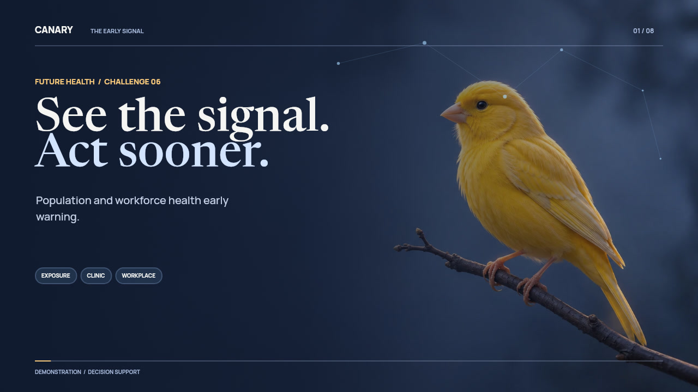](docs/media/canary-motion-demo.mp4)

[Open or download the MP4](docs/media/canary-motion-demo.mp4) · [Captions](docs/media/canary-motion-demo.srt) · [Transcript](docs/demo-transcript.md)

## Quick start

Install Python 3.12, [uv](https://docs.astral.sh/uv/getting-started/installation/), and Node.js 22 with npm.

```bash
git clone https://github.com/satiricalguru/Canary.git
cd Canary
uv sync --locked
./start.sh
```

Open the [website](http://localhost:3000) and [FastAPI docs](http://127.0.0.1:8000/docs). The launcher starts both services. The website uses its bundled demo endpoints by default, while the FastAPI service exposes the statistical pipeline separately.

<details>
<summary>Run just the website</summary>

```bash
cd frontend
npm ci
npm run dev
```

</details>

<details>
<summary>Validate the backtest and build</summary>

```bash
uv run pytest -q
uv run python -m eval.backtest --no-charts --output-dir /tmp/canary-eval
uv run python scripts/check_report.py /tmp/canary-eval/summary.json
cd frontend
npm ci
npm run build
```

</details>

## Validation


| Detector | Event sensitivity | Alert precision | False alerts per site-month | Median Canary timing |
| :--- | ---: | ---: | ---: | :--- |
| **Canary fusion** | **88.9%** | **92.3%** | **0.032** | — |
| Absence EARS C2 | 66.0% | 35.2% | 0.588 | 1 day earlier |
| Clinic CUSUM | 98.6% | 88.9% | 0.107 | 1 day later |
| Fixed exposure | 49.3% | 53.5% | 0.577 | 3 days later |

The backtest uses **144 injected events across three held-out simulation seeds**. Timing comparisons only include events found by both methods. Clinic CUSUM detected more events, especially gastrointestinal clusters. Canary returned higher precision and fewer false alerts per site-month than the clinic comparator. [Report](eval/reports/summary.json) · [Methods and limitations](docs/validation.md)

## How it works

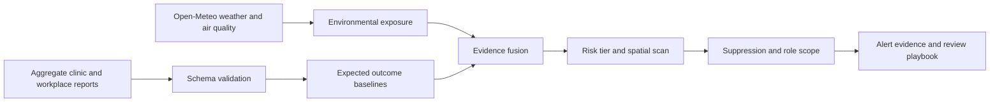

The backend accepts aggregate records and rejects person-level fields. Small values and related contributions are protected in scoped backend outputs. The website's privacy preview deliberately uses synthetic input examples to show how suppression works. Reviewers remain responsible for interpreting an alert and choosing a response. [Data governance](DATA_GOVERNANCE.md) · [Data contract](docs/data.md)

## Technical docs

| Document | What it covers |
| --- | --- |
| [Architecture](ARCHITECTURE.md) · [API](docs/api.md) | Engine, interfaces, storage, and response contracts |
| [Product requirements](PRD.md) · [Design](DESIGN.md) | Intended workflows, design system, and interaction |
| [Rules](RULES.md) · [Model card and assumptions](MODEL_CARD.md) | Model boundaries, operational assumptions, and evaluation |
| [Deployment](docs/deployment.md) · [Release audit](docs/release-audit.md) | Demo configuration, verification, and pilot gaps |

## Next steps

- [ ] Run a shadow-mode pilot with authorized aggregate feeds and a predefined alert budget.
- [ ] Calibrate thresholds on pilot data and review missed events by syndrome.
- [ ] Replace demo role selection with authenticated organization and site scope before connecting sensitive data.

## Contributors

See the [project contribution history](https://github.com/satiricalguru/Canary/graphs/contributors) for authorship. These contributors and automations helped build, verify, and ship Canary.

<table>
<tr>
<td align="center" width="25%"><a href="https://github.com/codex"><br><strong>OpenAI Codex</strong></a><br><sub>Implementation, QA, and showcase</sub></td>
<td align="center" width="25%"><a href="https://github.com/satiricalguru/Canary/actions"><br><strong>GitHub Actions</strong></a><br><sub>Builds, tests, and security checks</sub></td>
<td align="center" width="25%"><a href="https://github.com/apps/dependabot"><br><strong>Dependabot</strong></a><br><sub>Dependency updates</sub></td>
<td align="center" width="25%"><a href="https://github.com/apps/vercel"><br><strong>Vercel</strong></a><br><sub>Production deploys and commit status</sub></td>
</tr>
</table>

Canary is released under the [MIT License](LICENSE). Environmental inputs and forecast capabilities are documented by [Open-Meteo](https://open-meteo.com/en/docs/air-quality-api). The demo narration uses Sarvam Bulbul v3 with Ishita.

<div align="center"><sub><a href="#canary">Back to top ↑</a></sub></div>
