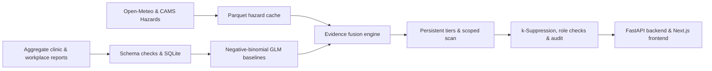

<div align="center">

# Canary

<p><strong>Explainable early warning for population and workforce health surveillance.</strong></p>
<p>Integrated full-stack platform for the Future Health Digital Innovation Challenge — Challenge 06.</p>

[](https://github.com/Mxhi-04/Canary/actions/workflows/ci.yml)
[](LICENSE)


<p>
  <a href="#quick-start">Quick start</a> · 
  <a href="#core-capabilities--screens">Core screens</a> · 
  <a href="#validation--benchmarks">Validation</a> · 
  <a href="docs/api.md">API contract</a> · 
  <a href="ARCHITECTURE.md">Architecture</a> · 
  <a href="docs/deployment.md">Deployment</a>
</p>

</div>

---

> **Core Principle:** *Exposure leads; outcomes confirm.*  
> **Status:** Submission target 20 November 2026

Canary combines environmental hazard exposure (particulate matter PM2.5/PM10, ambient heat, and WBGT thermal index) with aggregate clinic and workplace reports (syndromic clinic presentations, teleconsultation surges, and sickness absence). Exposure can trigger a **Watch**, and persistent corroborating evidence can raise an **Alert** or **Action**. When an anomaly is detected, Canary explains **what changed, why the system raised the alert, where and when it occurred, how reliable the evidence is, and what proportionate action a responsible human should consider**.

---

## Quick Start

### Fast Start (Full Stack)

Run both backend and frontend together and automatically launch your browser:

```bash
./start.sh
# or: make run
```

---

### Manual Start

#### 1. Backend (FastAPI & Engine)

Requirements: [uv](https://docs.astral.sh/uv/getting-started/installation/) and Python 3.12+.

```bash
# Clone and enter repo
git clone https://github.com/Mxhi-04/Canary.git
cd Canary

# Install dependencies and sync environment
uv sync --locked

# Start the FastAPI early-warning backend
uv run uvicorn backend.app.api.main:app --no-access-log
```

Open [Swagger UI](http://127.0.0.1:8000/docs). Try the [respiratory replay](http://127.0.0.1:8000/replay/respiratory?day=16) or inspect `/alerts/{alert_id}`.

### 2. Frontend (Next.js Surveillance App)

Requirements: Node.js 18+ and npm.

```bash
cd frontend
npm install
npm run dev
```

Open [http://localhost:3000](http://localhost:3000) to view the interactive Canary landing page, live Disease Surveillance Room, UAE / Dubai geospatial map, and role-based operational dashboard.

### 3. Docker Compose (Full-Stack)

```bash
docker compose up --build --wait
```

- Backend API: `http://127.0.0.1:8000`
- API Health Check: `http://127.0.0.1:8000/healthz`

---

## Core Capabilities & Screens

1. **Overview & Spatial Surveillance (`/` and `/map`)**:
   - UAE geospatial map across Abu Dhabi Central, Musaffah & ICAD, Al Ain, and Dubai South.
   - Semicircular operational gauges for data completeness, percentage of sites at Alert or above, and open Action alerts.
   - Ranked horizontal site bars by anomaly severity.
   - Exposure vs confirmatory outcome trends (European CAMS PM2.5 vs site clinic visits).
   - Real-time data quality and feed health auditing (detects and isolates delayed feeds).

2. **Live Disease Surveillance Room & Dubai Telemetry**:
   - Interactive bento grid matching blueprint specifications with glowing hotspot map, 3 circular gauges, spline trend chart, geographic spread, and outbreak sources.
   - Deep-dive District Telemetry Dossier with live clinical metrics, environmental indices, and synchronized site drawers.

3. **Alert Inbox (`/alerts`)**:
   - Multi-tiered operational queue categorized into **Watch (●)**, **Alert (▲)**, and **Action (◆)**.
   - Filterable by tier, hazard type (Respiratory, Gastrointestinal, Heat Stress), monitoring unit, and status.
   - Left-edge severity indicators, stream completeness meters, and uncertainty metrics.

4. **Explainable Alert Detail (`/alerts/[id]`)**:
   - Organized strictly under the **five core PRD questions**:
     1. *What changed*: Observed count vs rolling negative-binomial GLM baseline with 95% forecast interval.
     2. *Why Canary raised this*: Evidence contribution waterfall, evidence capping, correlation discounts, and persistence rules.
     3. *Where and when*: Geographic cluster zone, time window selector (1d, 3d, 7d), and spatial scan significance.
     4. *How reliable*: Stream completeness, sensor freshness, and missing feed handling.
     5. *What to consider doing*: Action playbook, designated owner role, supporting evidence, explicit assumptions, escalation criteria, review-by deadline, and authoritative WHO/ILO citations.
   - Mandatory human-review disclaimer bar and read-only demo sign-off workflow.

5. **Scenario Replay (`/replay`)**:
   - Interactive 14-day timeline scrubber with day ticks, play/pause controls, and keyboard navigation (`←`/`→`, `Space`).
   - Replays three distinct scenarios:
     - *Scenario 1:* Respiratory Dust / PM2.5 Episode (Musaffah Sector 14).
     - *Scenario 2:* Gastrointestinal Cluster in Shared Accommodation (ICAD Village 02).
     - *Scenario 3:* Heat-Related Illness & WBGT Thermal Stress (Dubai South Aviation District).
   - Real-time marker tracks comparing Canary against **EARS C2 (absence)** and **CUSUM (clinic visits)** baselines.

6. **Validation & Benchmarks (`/validation`)**:
   - Empirical back-testing summary on held-out synthetic test seeds (Calibration Seed 42, Test Seed 108).
   - Comparator matrix reporting event-level sensitivity, lead time (days), alert-level PPV, and false alerts per site-month.
   - Lead time advantage chart relative to the clinical-significance zero line (+2.9 days for Canary).
   - Ablation and robustness stress testing (evaluates feed removal, 48h reporting delays, and 30% noise).

7. **Privacy & Governance (`/privacy`)**:
   - Canonical 4-field aggregate data contract (`unit_id`, `date`, `category`, `count`).
   - Interactive ingestion testing sandbox that rejects prohibited person-level fields (`patient_id`, `employee_name`).
   - Live small-cell suppression engine with an interactive threshold slider ($k=3$ to $10$, default $k=5$) showing primary suppression and secondary total-protection suppression.
   - Server-enforced role access comparison across Site HSE, OH Lead, District Health Officer, and Regulator compliance views.
   - Immutable append-only audit event log.

8. **Health & Resilience Impact Estimator (`/impact`)**:
   - Low, Base, and High scenario impact calculator modeling averted worker sick days, prevented severe heat illness events, and operational savings across enterprise workforces.

---

## Validation & Benchmarks

<div align="center">
  
</div>

| Detector | Event sensitivity | Alert precision | False alerts per site-month | Median lead for Canary |
| :--- | :---: | :---: | :---: | :---: |
| **Canary** | **88.9%** | **92.3%** | **0.032** | — |
| Absence EARS C2 | 66.0% | 35.2% | 0.588 | 1 day earlier |
| Clinic CUSUM | 98.6% | 88.9% | 0.107 | 1 day later |
| Fixed exposure threshold | 49.3% | 53.5% | 0.577 | 3 days later |

Results cover 144 injected events across three held-out seeds. Lead time is calculated on events both detectors found. Canary had higher precision and fewer false alerts than clinic CUSUM. CUSUM detected more events, especially gastrointestinal clusters. The fixed exposure comparator has no GI rule. These are simulated operational results. [Full report](eval/reports/summary.json) · [Methods and limitations](docs/validation.md)

```bash
# Run backtest suite and tests
uv run python -m eval.backtest
uv run pytest -q
```

---

## How it works



Site HSE sees its assigned site. Occupational physicians can read assigned sites. District public health sees district summaries. The regulator view reports feed compliance indicators. Small counts and their diagnostic contributions are suppressed, and eligible district rollups are shown in bands. Alerts require human review and cannot be used for individual employment or disciplinary decisions. [Data contract and governance](docs/data.md)

---

## Documentation Links

- [System Architecture (ARCHITECTURE.md)](ARCHITECTURE.md)
- [Product Requirements Document (PRD.md)](PRD.md)
- [Clinical & Epidemiological Rules (RULES.md)](RULES.md)
- [Design Specifications (DESIGN.md)](DESIGN.md)
- [Data Governance & Privacy (DATA_GOVERNANCE.md)](DATA_GOVERNANCE.md)
- [Model Card & Safety Boundaries (MODEL_CARD.md)](MODEL_CARD.md)
- [API Contract Specification (docs/api.md)](docs/api.md)
- [Data Model & Catalog (docs/data.md)](docs/data.md)
- [Deployment Guide (docs/deployment.md)](docs/deployment.md)

---

## License and Sources

The code is available under the [MIT License](LICENSE). Weather and air-quality inputs come from Open-Meteo and the Copernicus Atmosphere Monitoring Service (CAMS), ECMWF. [Weather documentation](https://open-meteo.com/en/docs/historical-weather-api) · [Air quality documentation](https://open-meteo.com/en/docs/air-quality-api) · [Data use terms](https://open-meteo.com/en/terms)

Challenge requirements and submission details are published on the [official Future Health challenge page](https://hack2skill.com/event/futurehealthchallenge/).
